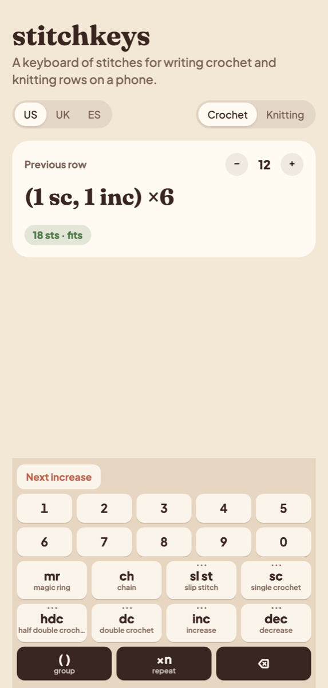
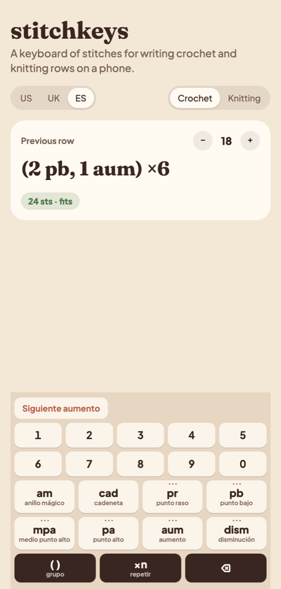
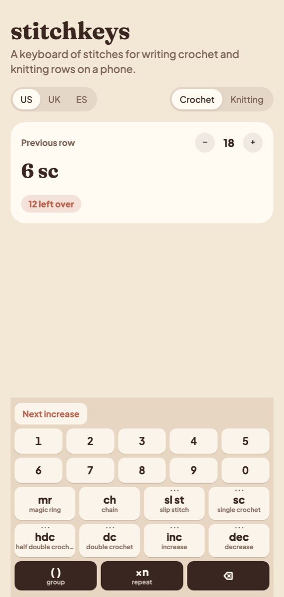
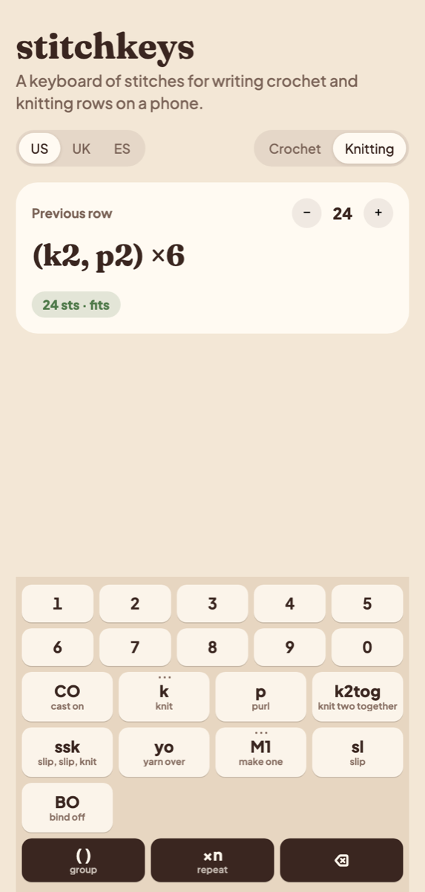

# stitchkeys

**A keyboard of stitches for writing crochet and knitting rows on a phone.**
Tap the count, then the stitch. Every row is counted as you type it and
checked against the row before.

**[Try the live demo →](https://jesusvaros.github.io/stitchkeys/)** · [npm](https://www.npmjs.com/package/stitchkeys)

<p align="center">
  
  
  
  
</p>

Nobody types `R3: *1sc, inc* x6 (18)` into a text box on a phone, yet every
pattern app still asks people to. stitchkeys is the missing input:

- **Count, then stitch:** `6` `inc` → **6 inc**. Group and repeat:
  `( )` `1` `sc` `1` `inc` `6` `×n` → **(1 sc, 1 inc) ×6**.
- **It checks your maths:** *“18 sts · fits”*, *“4 left over”*, *“2 short”*,
  against the previous row's stitch count.
- **Your terms:** US, UK or Spanish abbreviations, for the same row
  (UK dc = US sc = pb). Knitting rows read the way knitters write them: `k2, p2`.
- **Variants like accents:** hold a key with dots and slide to back loop only,
  front loop only, invisible decrease…
- **Small and themeable:** the core has no dependencies; the React keyboard
  is one component, styled through CSS custom properties.

It also works without the keyboard, as a library for reading, counting and
writing rows (`parseRow`, `checkRow`, `formatRow`).

## Try it

Open the **[live demo](https://jesusvaros.github.io/stitchkeys/)** on your phone, or run it locally:

```sh
git clone https://github.com/jesusvaros/stitchkeys && cd stitchkeys
npm install
npm run demo     # opens the phone-sized demo at http://localhost:5175
```

The demo takes a few query parameters, handy for screenshots:
`?locale=es&craft=crochet&previous=18&row=(2 sc, 1 inc) x6`
([example](https://jesusvaros.github.io/stitchkeys/?locale=es&craft=crochet&previous=18&row=(2%20sc,%201%20inc)%20x6)).

## Install

```sh
npm install stitchkeys
```

## React

```tsx
import { CROCHET, nextIncrease } from 'stitchkeys'
import { StitchKeyboard, useStitchInput } from 'stitchkeys/react'
import 'stitchkeys/react/styles.css'

function RowEditor({ previous }: { previous: number }) {
  const { state, setState, text, check, reset } = useStitchInput(CROCHET, { previous, locale: 'us' })
  return (
    <>
      <p>{text}</p>
      <p>{check.status === 'ok' ? `${check.produces} sts` : check.status === 'left' ? `${check.difference} left over` : ''}</p>
      <StitchKeyboard
        catalog={CROCHET}
        locale="us"
        state={state}
        onChange={setState}
        quick={[{ label: 'Next increase', onPress: () => reset(nextIncrease(previous) ?? []) }]}
      />
    </>
  )
}
```

`StitchKeyboard` props:

| Prop | |
|---|---|
| `catalog`, `locale` | `CROCHET` or `KNITTING`; `'es'`, `'us'` or `'uk'` |
| `state`, `onChange` | the typing state (from `useStitchInput` or your own) |
| `keys` | stitch ids to show, in order (default: the whole catalog) |
| `quick` | shortcut buttons above the keys |
| `onTextRequest` | shows an **Aa** key, for switching to free text |
| `onKeyPress` | called on every press (for example, a haptic tick) |
| `labels`, `holdMs` | control-key labels; long-press delay |

### Theming

The default styles live entirely on `.sk-*` classes and custom properties:

```css
.my-editor .sk {
  --sk-bg: #eee; --sk-key: #fff; --sk-key-fg: #222; --sk-key-sub: #777;
  --sk-control: #222; --sk-control-fg: #fff; --sk-accent: #c0583f;
  --sk-radius: 10px; --sk-gap: 6px; --sk-font: inherit;
}
```

## Core

```ts
import { CROCHET, parseRow, formatRow, checkRow, rowTotal } from 'stitchkeys'

const row = parseRow(CROCHET, '*2 sc, inc* x6 (24)')
formatRow(CROCHET, row, 'es')       // '(2 pb, 1 aum) ×6'
formatRow(CROCHET, row, 'uk')       // '(2 dc, 1 inc) ×6'
checkRow(CROCHET, row, 18)          // { consumes: 18, produces: 24, status: 'ok', difference: 0 }
rowTotal('*2 sc, inc* x6 (24)')     // 24
```

- `parseRow(catalog, text)` reads `6 sc`, `sc 6`, `6sc`, `(…) x6`, `*…* x6`,
  `6 sc in magic ring`, `sc blo` and the common Spanish spellings. What it
  cannot read stays as a `text` token, so nothing is lost.
- `checkRow(catalog, row, previous)` returns what the row consumes and
  produces, and whether it fits a previous row of `previous` stitches:
  `ok`, `left`, `short`, or `unchecked` (a starting row, or one with free
  text).
- Typing, as pure functions: `typeDigit`, `typeStitch`, `typeGroup`,
  `typeTimes`, `typeText`, `backspace`, and `formatInput` (the row as it
  reads mid-typing, e.g. `(1 sc, 1`). You can use them to build a keyboard
  for any framework.
- Shapes: `nextIncrease(previous)`, `nextDecrease(previous)` and
  `evenRound(previous)` give the classic amigurumi sphere rounds.

### Catalogs

| Crochet | es | us | uk |
|---|---|---|---|
| magic ring | am | mr | mr |
| chain | cad | ch | ch |
| slip stitch | pr | sl st | ss |
| single crochet | pb | sc | dc |
| half double | mpa | hdc | htr |
| double | pa | dc | tr |
| increase | aum | inc | inc |
| decrease | dism | dec | dec |

Knitting: cast on, k, p, k2tog, ssk, yo, M1 (L/R), sl, bind off.

Each stitch says how many stitches it `consumes` from the previous row and
`produces` for the next one, so you can add your own catalog:

```ts
const MINE: Catalog = { craft: 'crochet', stitches: [...CROCHET.stitches, { id: 'puff', abbr: { es: 'puff', us: 'puff', uk: 'puff' }, name: { es: 'punto puff', en: 'puff stitch' }, consumes: 1, produces: 1 }] }
```

## Use it in your project

- **React:** `StitchKeyboard` + `useStitchInput`, as above. Put the keyboard
  where the phone's keyboard would be (the bottom of the screen) and show
  `text` and `check` above it.
- **Any other framework:** the typing functions are pure (`typeDigit`,
  `typeStitch`, `typeGroup`, `typeTimes`, `backspace`, `formatInput`), so a
  Vue, Svelte or plain DOM keyboard is a thin layer of buttons over them.
- **Server or scripts:** `parseRow` + `checkRow` validate rows written by
  hand or by an importer, for example to flag a round whose total does not
  add up.

The keyboard fits phones from 320 px wide; long stitch names are shortened
with an ellipsis rather than widening it. Its control keys speak the
keyboard's language (Spanish for `es`, English for `us` and `uk`) and can be
renamed through `labels`.

## Status

0.1. Crochet works end to end; it was born in Lanuki, a pattern app for
crochet and knitting, where it is the row editor. The knitting
catalog has its counts and notation, but its keyboard layout has not yet
been tested with knitters: feedback welcome.

## License

MIT
